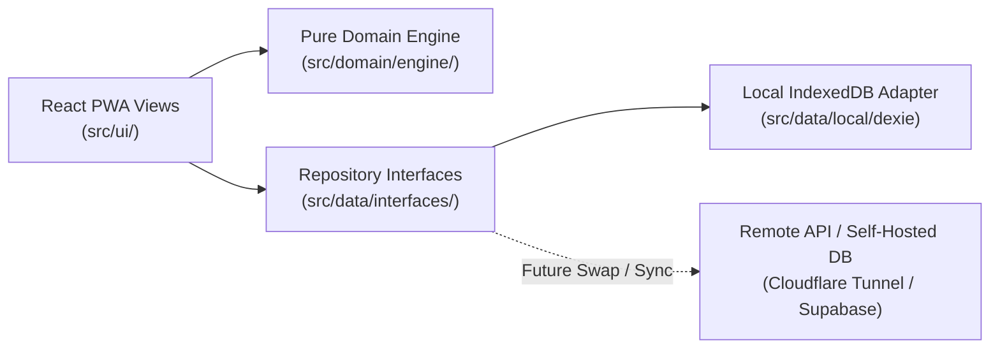

# Architecture & System Design

## 1. Architectural Goals

**Beast Mode** is architected as a **Clean / Hexagonal Progressive Web Application (PWA)**:
1. **Local-First Today**: Runs 100% in the browser using **IndexedDB (via Dexie.js)** with zero server costs, full offline support, and static hosting on **GitHub Pages**.
2. **Backend-Ready Tomorrow**: All business rules (`src/domain/`) and storage contracts (`src/data/repositories/`) are decoupled from React components and IndexedDB. Moving to a hosted backend (e.g., Supabase, PocketBase/SQLite over Cloudflare Tunnels or Tailscale, or a custom REST/GraphQL server) only requires implementing the repository interfaces in `src/data/remote/` and adding an authentication wrapper.

---

## 2. Layered Directory Structure

```text
beast-mode/
├── docs/
│   ├── ARCHITECTURE.md      # System architecture & migration guide
│   ├── WORKOUT_LOGIC.md     # Domain rules, splits, safeguards & seed spec
│   └── ROADMAP.md           # Phased milestones & task tracker
├── src/
│   ├── domain/              # PURE TYPESCRIPT — Zero UI or DB dependencies
│   │   ├── models/          # Entities: Exercise, SupersetPair, WorkoutSession, LiftSet, PlanConfig
│   │   ├── engine/          # Pure business logic:
│   │   │   ├── sequencer.ts         # Next session & primary lift recommendation engine
│   │   │   ├── loads.ts             # Weight suggestions (last recorded / estimate) & drop-set weights
│   │   │   ├── sessionSummary.ts    # Shareable per-exercise summary of a workout (top weight, sets)
│   │   │   ├── splits.ts            # Split labels, buddy-day & spotter-safety helpers, legacy data migration
│   │   │   ├── rulesEngine.ts       # Axial load, antagonist pairing, intra-session overlap, 48h lookback
│   │   │   ├── volumeTracker.ts     # 7-day & 14-day muscle volume balance & superset recommender
│   │   │   └── oneRepMax.ts         # Epley/Brzycki 1RM & main lift progression calculators
│   │   ├── catalog/
│   │   │   └── pickerOptions.ts     # Picker labels, body-region grouping, equipment filters & search ranking
│   │   └── seed/            # Default exercises, curated supersets, finisher protocols, split templates
│   ├── data/                # DATA ACCESS LAYER — Repository interfaces & adapters
│   │   ├── interfaces/      # Async repository contracts (IWorkoutRepository, IPlanRepository, etc.)
│   │   ├── local/           # Dexie.js (IndexedDB) implementation + JSON export/import backup
│   │   └── context/         # Dependency Injection provider so UI only talks to IRepository interfaces
│   └── ui/                  # PRESENTATION LAYER — React + TypeScript + Tailwind CSS
│       ├── components/      # Reusable UI building blocks
│       │   ├── SelectSheet.tsx          # STANDARD data picker: searchable bottom sheet w/ sub-headings, filter chips, labels.
│       │   │                            # Use this (not native <select>) anywhere the user picks an item from data.
│       │   ├── ExercisePicker.tsx       # ExercisePicker & SupersetPicker built on SelectSheet
│       │   ├── MultiSelectFilter.tsx    # STANDARD multi-select filter (pill trigger + checkbox sheet); use instead of chip rows
│       │   ├── BottomSheet.tsx          # Shared sheet chrome used by SelectSheet & MultiSelectFilter
│       │   ├── BuddyToggle.tsx          # Per-session Buddy/Solo switch + small buddy badge
│       │   └── ScrollCarousel.tsx       # STANDARD horizontal strip: swipe + snap, hidden scrollbar, edge arrows
│       ├── share/           # sessionShareImage.ts: draws the summary as a PNG and opens the share sheet
│       ├── views/           # 5 Core Pages:
│       │   ├── PlanView.tsx             # 14-day calendar, lightweight session planning, 4-color health & Quick Switch, Current vs Future loading
│       │   ├── CurrentSessionView.tsx   # Active gym floor session tracker (weights, reps, 2/3 set toggles, pivot split, complete/abandon)
│       │   ├── HistoryView.tsx          # Bench/Squat/Deadlift progress charts, 28-day calendar & session inspector with editable notes
│       │   ├── CatalogView.tsx          # Searchable superset & exercise directory with execution directions & form cues
│       │   └── SettingsView.tsx         # Plan config (split, buddy days, sessions/week), volume ceilings, equipment weightings & JSON backup
│       └── App.tsx
```

---

## 3. Repository Pattern & Future Hosting Migration Path

### Repository Contract (`src/data/interfaces/repositories.ts`)
All data operations are asynchronous (`Promise<T>`) even when backed by local IndexedDB:
- `IExerciseRepository`: Query seed and custom exercises, curated supersets, and finisher templates.
- `IPlanRepository`: Read and update the active training schedule (`PPL` vs `UPPER_LOWER`, `2 | 3 | 4` days/week, buddy weekdays).
- `ISessionRepository`: Save, update, list, and query `WorkoutSession` logs across arbitrary date windows (48h, 7d, 14d, all-time) and export/import full JSON snapshots.

### Migration Options When Moving Beyond Local-Only

| Hosting Strategy | How It Fits This Architecture | Cost |
| :--- | :--- | :--- |
| **Phase 1: GitHub Pages + IndexedDB (Current)** | Static PWA deployed via GitHub Actions. Uses `DexieRepository`. Users can share/backup data via JSON export/import. | **$0 / mo** |
| **Phase 2A: Self-Hosted (PocketBase / SQLite) + Cloudflare Tunnel or Tailscale** | Run a single PocketBase binary or lightweight Node/Go container on a home server/Raspberry Pi/NAS. Expose privately via Tailscale or publicly via Cloudflare Zero Trust Tunnel. Implement `PocketBaseRepository`. | **$0 / mo** |
| **Phase 2B: Cloud Hobby Tier (Supabase / Turso / Cloudflare D1 + Workers)** | Keep GitHub Pages (or Cloudflare Pages) for frontend; swap `RepositoryContext` to `SupabaseRepository` or keep `DexieRepository` with a background sync queue. | **$0 / mo** (Free Tier) |

---

## 4. Data Flow Diagram


